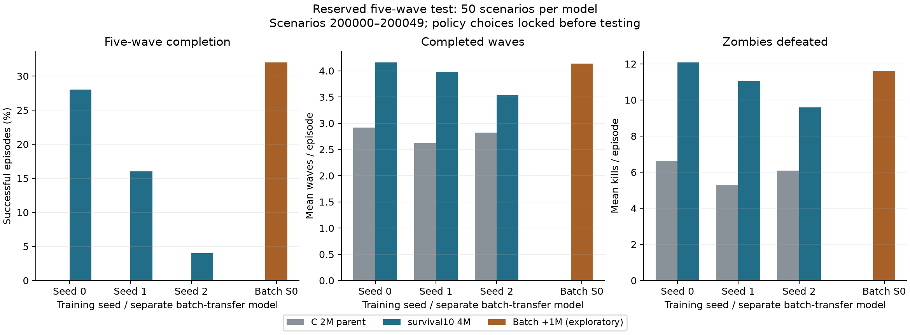
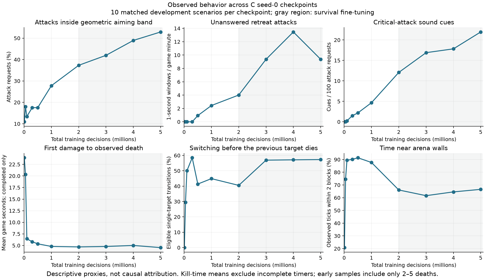
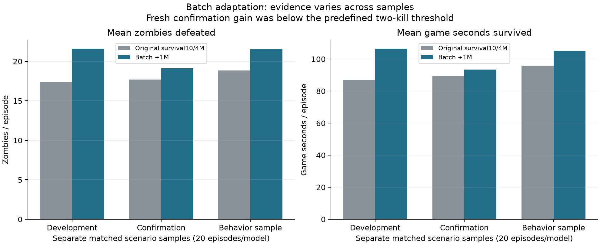

# Final policy and behavior study

**Status: reserved test complete.**

The final five-wave recipe is **survival10/4M across seeds 0–2**, with seed 0 selected for demonstration before testing. The **batch +1M seed-0 model** remains a separate exploratory demonstration policy. See [the pre-test selection](SELECTION.md).

## Reserved five-wave test

All 350 reserved episodes completed. The three survival10/4M models won 24/150 episodes (16.0% mean success), versus 0/150 for their C/2M parents (0.0%). Mean completed waves were 3.89 ± 0.32 versus 2.79 ± 0.15; mean kills 10.90 ± 1.26 versus 5.99 ± 0.67 (mean ± sample SD across the three trained models). Paired changes in waves were seed 0: +1.24, seed 1: +1.36, seed 2: +0.72. The preselected seed-0 demonstration model completed all five waves in 14/50 tests (28%). The separate batch +1M model achieved 16/50 (32%) on this five-wave transfer test. A single 50-episode comparison is insufficient to establish consistent superiority of that batch model; it does not change the pre-test selection. These are combined extra-training/settings effects, not a controlled reward-only ablation. Three training-seed lineages provide limited evidence about run-to-run variability. All policies used the same 50 reserved spawn/yaw scenarios in the original arena; this does not test new worlds, equipment or enemy types. The pre-test policy choices remain unchanged, and the reserved scenarios are now consumed: further optimization needs a new untouched evaluation set.

| Model | Wins | Success | Mean waves | Mean kills | Mean game seconds |
| --- | ---: | ---: | ---: | ---: | ---: |
| parent_2M_seed0 | 0/50 | 0.0% | 2.92 | 6.62 | 46.37 |
| survival10_4M_seed0 | 14/50 | 28.0% | 4.16 | 12.08 | 59.94 |
| parent_2M_seed1 | 0/50 | 0.0% | 2.62 | 5.28 | 41.38 |
| survival10_4M_seed1 | 8/50 | 16.0% | 3.98 | 11.04 | 59.40 |
| parent_2M_seed2 | 0/50 | 0.0% | 2.82 | 6.08 | 43.23 |
| survival10_4M_seed2 | 2/50 | 4.0% | 3.54 | 9.58 | 54.60 |
| batch_plus1M_seed0 | 16/50 | 32.0% | 4.14 | 11.60 | 58.80 |

## Behavior interpretation

### Aiming: clear improvement in the geometric proxy

The share of attack requests in the aiming band rises from 13.4% at 102k decisions to 48.9% at 4M. At 4M, 1,151/1,837 measured turns reduce yaw error by more than one degree (62.7%). Damage per attack request rises from 0.84 to 2.35 HP. This supports better aiming/attack coordination. The band targets the nearest visible torso and is not an exact entity raycast; initial action bias already favored steady aim and attacking.

### Hit-and-retreat: strong descriptive evidence of kiting-like behavior

No qualifying unanswered retreat windows occur through the 297k checkpoint. At 502k, seven appear across six of ten episodes. At 4M, 134 of 237 retreat windows deal damage with none received, across all ten episodes. Their rate increases from 4.01/game minute at 2M to 13.46 at 4M. These windows require backward commands, measured player motion away from a nearby visible zombie, and an attack. Enemy knockback alone does not qualify. They support hit-and-retreat behavior, not proof of deliberate reach management or invulnerability.

### Critical hits: behavior emerges and becomes common

The scripted sensor controls passed. Critical sound cues are absent at the sampled 10k/51k checkpoints and appear at 102,400 decisions in both the earlier crit study and this separate behavior pass. At 4M there are 184 cues per 1,032 attack requests (17.8/100), versus 0.23/100 at 102k. This is the earliest sampled evidence, not the exact learning step. Cues are deduplicated nearby sounds rather than server-side hit events, and the policy receives no explicit crit observation or bonus.

### Focus fire: faster observed kills, but no consistent single-target discipline

Mean first-damage-to-observed-death time decreases from 6.44s at 102k (29 completed, 15 incomplete) to 5.01s at 4M (111 completed, 25 incomplete). However, the 4M policy switches before the previous target dies in 96/168 eligible transitions (57.1%). Multiple zombies are wounded during 39.7% of multi-enemy ticks, versus 26.2% at 102k. Faster kills therefore do not establish improved focus fire. Later models face more enemies/waves; sweeps and environmental damage complicate attribution. Multi-target damage ticks are excluded from ordered target-switch transitions.

### Walls and attack timing: progress with remaining weaknesses

The 4M policy spends 64.6% of ticks near walls, down from 89.4% at 102k, but still most of the episode. It escapes 16 observed wall intervals, while 10 end unfinished; only 1 escape occurs within five seconds. Incoming damage is 0.436 HP/s near walls versus 0.185 away, a descriptive association with different combat exposure. Median attack-request spacing is 12 game ticks (0.6s) at both 102k and 4M, so later efficiency is not simply a faster attack-request cadence. Enemy reacquisition does not show a consistent monotonic improvement.

## Batch adaptation

The selected batch model gains 4.25 kills on the development sample, but only 1.40 on fresh confirmation (19.1 versus 17.7), below the predefined two-kill threshold. The later behavior sample is favorable again (21.55 versus 18.85 kills), but cannot retroactively replace the confirmation rule. Batch kill time changes little (4.52s to 4.42s), while switching increases (53.0% to 56.2%). The fixed recordings show 12, 24 and 42 kills; 42 is the strongest demonstration, not an average. Keep this model as an exploratory batch demo.

## Limits and measurement audit

These are descriptive observations from one training-seed lineage across checkpoints, with ten matched scenarios each; batch comparisons use twenty. Minecraft AI randomness is not bit-exact. Checkpoints visit different health, wave and enemy-count contexts. Survival fine-tuning changes several settings together at 2M. No ablation establishes causal acquisition, intention or optimality. Means pool eligible opportunities; per-episode evidence and denominators accompany them. Three episodes record one more health-zero death than the player's kill counter, always on the player-death tick. This is consistent with update timing or attribution differences, not proof of a player kill. Those primary clocks are labeled observed deaths; excluding the three ambiguous terminal deaths changes each affected mean by less than 0.005 seconds. There are no lost-entity or initially-injured exclusions in these particular traces; unfinished damaged zombies are still excluded from completed-only means and counted separately. Startup recovery reused validated completed outputs across two operational source revisions. The Windows cleanup adjustment changes startup handling, not combat inputs or rewards.

## Reproducible evidence

The [compact behavior data](behavior-summary.json), [episode summaries](episode-summary.json), [critical sensor controls](critical-controls.json), [earlier crit history](critical-history.json), [batch evidence](batch-evidence.json), [frozen test manifest](test-manifest.json), [final policy paths and hashes](final-policies.json), and [hash provenance](provenance.json) accompany this report. Per-model reserved-test CSVs, evaluation metadata and `reserved-test-results.json` are exported when complete. Full checkpoints, raw traces and videos remain outside Git in the project output directories.

Rebuild with `python scripts/report_final_study.py --outputs <project-outputs> --output reports/final-study-20261122`.
