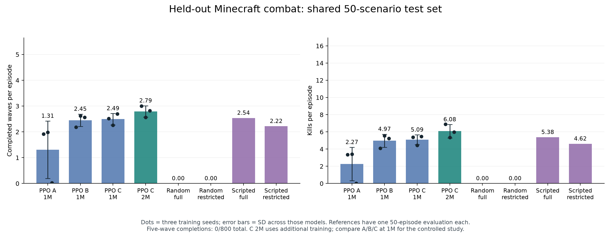
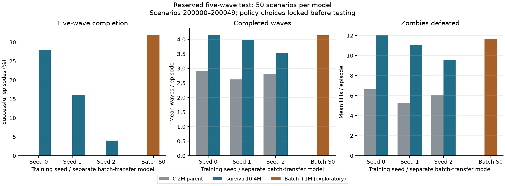
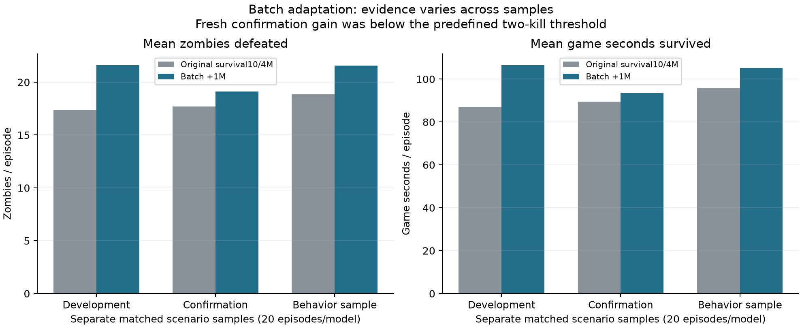
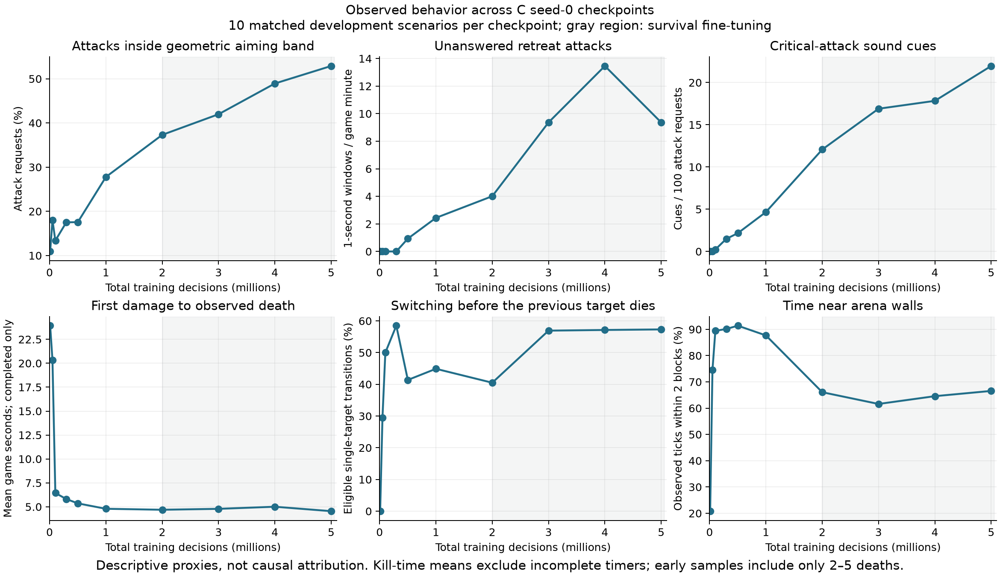

# Teaching an agent to fight zombies in Minecraft

## A plain-English walkthrough of the CS557 project

Prepared November 24, 2026 for the November 25 collaborator meeting. Results are from the completed November 21-22 experiments.

### The whole project in one minute

We built a small computer-controlled player that learns to fight zombies in real Minecraft. It tries actions, gets points for useful outcomes, and gradually changes how it plays. During combat, the learned policy chooses its aim and movement; there is no scripted target lock or retreat controller.

The main challenge is to survive five waves: first one zombie, then two, then three, then four, then five. That is 15 zombies in total. Health carries over, so surviving an early wave with little health makes the later waves much harder.

Our first models could fight, but none finished all five waves in the original test. After more training and changes that made taking damage more costly, the selected model could finish the task. It won **14 of 50 new test episodes, or 28%**. That is a real improvement, but it still loses most attempts.

We also tried a different challenge: repeatedly spawn groups of three zombies. A demonstration model defeated **42 zombies** in one recording. That is a good example of what it can do, not its usual score. Its fresh confirmation average was **19.1 kills**.

### What we can show tomorrow

- A complete five-wave win: 15 kills in 67.4 seconds of game time.
- A strong batch demonstration: 42 kills across 14 batches in 196.25 seconds.
- Another batch demonstration: 24 kills across eight batches in 123.5 seconds.
- Results from two separate tests: 800 original test episodes and 350 later reserved test episodes.
- Evidence of better aiming, more critical-hit cues, and useful attacks while retreating.

### What this project is actually studying

The original question is whether extra reward feedback and a more limited view of enemies change how well an agent learns combat. Later work asks whether more training and survival-focused settings improve the policy, and what behaviors appear along the way.

This is a controlled combat experiment. It is not an agent that understands all of Minecraft, learns from screen pixels, crafts items, or explores arbitrary worlds.

Start with the [meeting index](README.md). The [original study](../study-20261121/README.md) and [final study](../final-study-20261122/README.md) contain the detailed numbers behind this guide.

<!-- pagebreak -->

## 1. What the player sees and does

### The arena keeps the problem manageable

The player fights inside an enclosed arena with an iron sword and iron armor. Zombies are ordinary adult zombies without weapons or armor. Natural spawning and natural health regeneration are disabled. The arena, equipment and basic rules stay fixed so the comparisons are meaningful.

An **episode** means one attempt, starting with full health and ending in death, five completed waves, or the time limit. The original limit is 3,000 decisions, normally 600 seconds of game time. The computer can simulate game time faster than real time.

### The model receives numbers, not a screenshot

Its input contains the player's health, position, direction, camera angle and current wave. It also contains relative positions and health for up to five enemies. It receives four recent observations and the preceding actions, giving it a short history of what just happened. Together these form 156 input numbers.

Conditions A and B receive enemy information from all directions. Condition C receives enemy information only inside a 100-degree horizontal cone in front of the player. A previously visible enemy may still appear in the short history. This is a visibility filter on game data, not human-like vision or a test of whether walls block sight.

### The model chooses ordinary game controls

It can move forward or backward, strafe left or right, turn horizontally, look up or down, jump, sprint and attack. It chooses these controls together. It does not control inventory, crafting or equipment changes.

One decision normally covers four Minecraft ticks, about 0.2 seconds. A camera turn happens once per decision. Attacks use a press followed by a release so Minecraft recognizes the next attack; the normal weapon cooldown still applies. There is no automatic target lock.

### The important terms

| Word | What it means here |
| --- | --- |
| Agent | The computer-controlled player |
| Policy | The model that chooses the next controls |
| Reward | A score that guides learning |
| Checkpoint | A saved copy of the model |
| Training seed | A different randomized learning run |
| Scenario seed | A chosen starting layout and direction for an episode |

Implementation: [task.py](../../combat_rl/task.py), [env.py](../../combat_rl/env.py), and the [comparison settings](../../configs/comparison.json).

<!-- pagebreak -->

## 2. How learning works

### The loop repeats millions of times

1. Minecraft provides the current game state.
2. Our code turns it into the input numbers the policy is allowed to see.
3. The policy chooses controls, and Minecraft advances.
4. Our code measures what changed: kills, waves, damage and elapsed time.
5. Those changes produce a reward.
6. After collecting experience, the learning algorithm adjusts the policy.

We use **PPO**, short for Proximal Policy Optimization. In plain language, it nudges the model toward actions that worked better than expected while limiting how much the model changes at once. The network is small: two hidden layers with 128 units each. This is not a large language model.

### The original three-way comparison

| Condition | What earns or loses reward | Enemy information |
| --- | --- | --- |
| A | Kills, completed waves, death and elapsed time | All directions |
| B | A, plus feedback for damage dealt and taken | All directions |
| C | Same reward as B | Front 100-degree cone |

The extra feedback in B and C is called **reward shaping**. A hit can earn feedback before the zombie dies, which gives the model more frequent clues about useful actions.

In the actual comparison settings, a kill gives +1, a wave gives +3, and death gives -5. B and C also get +5 for dealing 20 health points of damage and lose 1.5 for taking 20 health points. These are training points, not damage bonuses applied to the sword.

### Does speed matter?

Yes, a little. Every game tick costs 0.001 reward, so waiting is not free: one game second costs 0.02 points. PPO also gives later rewards less weight than immediate rewards. There is no separate large fast-completion bonus. The later behavior measurements did not add rewards for aiming, critting, kiting or focus fire.

### Early training gets help, then that help goes away

Every condition starts with one wave, reaches three waves after 100k decisions, and five after 300k. Early first encounters are closer and easier to face; ordinary starting geometry is restored by 200k. The initial model also favors attacking while keeping movement and aim steady. These shared starting aids are part of the experiment, not evidence that the model already learned those behaviors.

Evaluation always uses ordinary starts. All A/B/C runs use the same training budget and aids. Exact weights and schedules are in [comparison.json](../../configs/comparison.json).

<!-- pagebreak -->

## 3. What the original experiment found

We trained A, B and C three times each, using training seeds 0, 1 and 2. Each run received about one million decisions. That is nine freshly trained models. We kept the weak runs in the results; we did not report only the best seed.

We used development episodes to compare candidates. B and C performed similarly, and the selection rule chose C for further work. Continuing C to about two million decisions improved its development results across all three seeds. A lower-learning-rate alternative did not pass screening.

We then tested the nine original models, the three C/2M continuations, and four random or scripted references. Each received 50 test scenarios. That made **800 episodes** in the original held-out test.

| Model group | Mean completed waves | Mean kills | Five-wave wins |
| --- | ---: | ---: | ---: |
| A at 1M | 1.31 | 2.27 | 0/150 |
| B at 1M | 2.45 | 4.97 | 0/150 |
| C at 1M | 2.49 | 5.09 | 0/150 |
| C continued to 2M | 2.79 | 6.08 | 0/150 |

The practical reading is that the shaped-reward agents did better than A in these runs. B and C were close, so we cannot claim that the restricted field of view made C better. The 2M continuation helped, but no tested controller beat all five waves in this first study.

Random controllers made no kills. The scripted full-view controller averaged 2.54 waves and 5.38 kills; the restricted-view version averaged 2.22 waves and 4.62 kills. Neither finished five waves. The planned human comparison has not been collected.

Source: [800 episode records and study summary](../study-20261121/README.md). Each PPO group has three trained models, not 150 independent training runs.

<!-- pagebreak -->

## 4. How we got a five-wave winner

The next experiment started from the three C/2M models. We used new development scenarios and reserved a second, untouched test set. The original test stayed closed.

The selected recipe is called **survival10** because its damage-taken penalty is 10 instead of 1.5 per 20 health points. It also uses a smaller learning rate and changes how much future reward matters. We continued training and selected checkpoints at about **four million total decisions**. This includes the earlier two million; it is not four million extra.

The recipe improved development results in all three seed lineages. Seed 0 was selected for the main demonstration before testing. A later 5M checkpoint did not replace it under the development selection rule.

### The reserved test was the final exam

We locked the checkpoint choices and file hashes first. Then we ran seven models on 50 reserved scenarios each: three C/2M parents, their three survival4M descendants, and the separate batch-adapted model. That made **350 episodes**. No learning happened during testing.

| Model | Five-wave wins | Mean completed waves |
| --- | ---: | ---: |
| C/2M parents, all three combined | 0/150 | 2.79 |
| Survival4M seed 0 | 14/50 (28%) | 4.16 |
| Survival4M seed 1 | 8/50 (16%) | 3.98 |
| Survival4M seed 2 | 2/50 (4%) | 3.54 |
| Batch +1M, separate transfer test | 16/50 (32%) | 4.14 |

Together, the survival models won 24/150 episodes and averaged 3.89 waves. All three improved over their own parents, but performance varies substantially between training runs.

Keep **survival4M seed 0** as the five-wave demonstration policy. The batch model's two extra test wins do not establish consistent superiority or justify changing a choice after looking at the test. This experiment changed both training time and several settings, so it cannot tell us which individual change caused the improvement.

Source: [final test, policy lock and per-model records](../final-study-20261122/README.md).

<!-- pagebreak -->

## 5. Why we added the batch challenge

Spawning a new zombie every couple of seconds can quickly pile up enemies. The player may be overwhelmed before it finishes the current fight. We therefore tried two different ways of continuing combat.

- **Timed mode:** another zombie arrives every fixed number of seconds, even while old zombies are alive.
- **Batch mode:** spawn k zombies, wait until all k are defeated, then spawn the next k. Health still carries over, with no between-batch healing.

We calibrated timed intervals of 2, 4 and 6 seconds and batch sizes of 1, 2, 3 and 5. The fixed rule chose **batches of three**. These episodes have a 300-second game-time cap. Batch mode is a different task, so its kill totals are reported separately from five-wave results.

We fine-tuned a copy of the survival seed-0 model. Checkpoints received 250k, 500k, 1M and 2M extra decisions. Development results selected the **+1M** checkpoint, about five million total decisions.

| Sample | Parent mean kills | Batch +1M mean kills |
| --- | ---: | ---: |
| Development, 20 episodes each | 17.35 | 21.60 |
| Fresh confirmation, 20 each | 17.70 | 19.10 |
| Later behavior sample, 20 each | 18.85 | 21.55 |

The fresh confirmation improved by 1.4 kills, below the predeclared requirement of at least two. We therefore call this an **exploratory demonstration policy**, not a confirmed upgrade. The later favorable behavior sample does not erase that failed confirmation.

The three fixed batch recordings scored 12, 24 and 42 kills. We included the two strong runs for the meeting and labeled them as showcases. The 42-kill run lasted 196.25 game seconds and cleared 14 batches. A timed two-second-arrival recording with the same model managed only five kills in 30.3 seconds, illustrating the difficulty difference.

Source: [batch protocol](../../docs/endless-calibration.md), [batch evidence](../final-study-20261122/batch-evidence.json), and [video details](media-index.json).

<!-- pagebreak -->

## 6. What behaviors seem to develop

We replayed ten saved checkpoints from one training lineage, from about 10k to 5M decisions, on ten matched scenarios each. We also ran references and batch comparisons: **170 diagnostic episodes** altogether. Passive logging measured what happened without giving the policy extra information or rewards.

**Aiming improves.** At 102k decisions, 13.4% of attack requests fell inside our geometric aiming band. At 4M, 48.9% did. Damage per attack request rose from 0.84 to 2.35 health points. The band is an approximation, not an exact crosshair hit test.

**Critical-hit behavior appears.** Critical-attack sound cues first appeared at the sampled 102k checkpoint. At 4M there were 184 cues across 1,032 attack requests, about 17.8 per 100. We tested the sensor with grounded and falling scripted attacks. It measures sound evidence, not a perfect server-side hit counter.

**Attacking while retreating becomes useful.** At 4M, 134 measured one-second retreat windows dealt damage without receiving damage. The checks require backward commands, actual movement away from a nearby enemy and an attack. This supports kiting-like behavior, but does not prove deliberate reach management.

**Focus fire is not clearly learned.** Mean time from first damage to observed zombie death fell from 6.44 seconds at 102k to 5.01 at 4M. However, the 4M policy switched away from a still-living target in 57% of eligible transitions. It still spreads damage around. Unfinished damaged zombies are counted separately and excluded from that mean.

**Walls remain a weakness.** The 4M model spent about 65% of observed ticks near walls. Incoming damage was higher there, although the combat situations also differ.

These measurements show patterns, not intention or the exact moment something was learned. Later checkpoints also reach harder waves. See the [measurement definitions and limitations](../final-study-20261122/README.md) and [raw behavior evidence](evidence/behavior/).

<!-- pagebreak -->

## 7. How to present this honestly and finish the project

### Keep practice, exams and highlights separate

Training changes the policy. Development evaluations help us choose settings and checkpoints. A held-out test measures the choice after it is frozen. A video is one demonstration, not a win-rate estimate.

The original test used scenarios 100000-100049. The later reserved test used 200000-200049. Both are now observed. Further optimization would need new untouched evaluation scenarios; it cannot turn these same tests into fresh evidence.

Matching scenario seeds controls starting layouts and directions, but Minecraft's internal behavior is not bit-for-bit repeatable. The two tests use different scenario sets and serve different stages of the project. Within the final test, compare the parents and descendants evaluated on the same set.

### What is solid, and what is still limited

- Real Minecraft runs, trained models, episode records, recordings and graphs exist. The main reported tests are complete.
- The best preselected five-wave demonstration policy can win, but its measured win rate is 28%, not close to 100%.
- Three training seeds provide limited evidence about repeatability. One strong video cannot fix this limitation.
- The behavior study mainly follows one training lineage. It does not prove that crits or retreating caused the performance gain.
- The agent receives structured game data. Results do not establish pixel-based vision, human-level play, or generalization to other worlds, enemies or equipment.

### The engineering work that made it possible

The project runs on native Windows with Python 3.11, Java 21, Minecraft 1.21, CraftGround and Stable Baselines3. A small policy runs on the CPU; one Minecraft simulator runs at a time. We fixed attack press/release handling, reset-statistic accounting, startup and process cleanup issues, then used frozen code and saved checkpoints for the experiments.

Some long jobs were interrupted. Recovery preserved failures, checked completed artifacts and reused verified results. One late batch-training checkpoint lacked a supervisor completion receipt; its integrity was checked, but that old process exit was not labeled clean. The final reserved test completed all seven evaluations cleanly with unchanged checkpoints.

### The remaining work is mainly communication

The human contextual benchmark is still pending. The team still needs its final course report and presentation. Tomorrow, agree on the main claims, choose the demo clips, assign writing and figure responsibilities, and decide whether the human benchmark is worth the remaining time.

The [meeting index](README.md) links every result, graph, video and model. [Reproduction instructions](REPRODUCE.md) explain how to load the portable checkpoints and use development scenarios for a new demo. Nothing is currently queued to train or evaluate.
