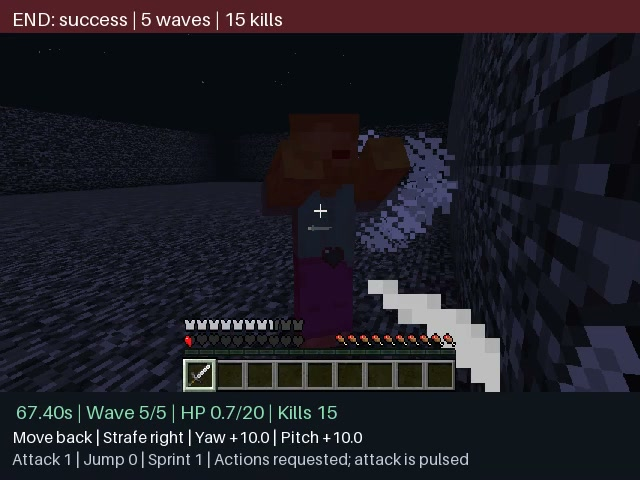
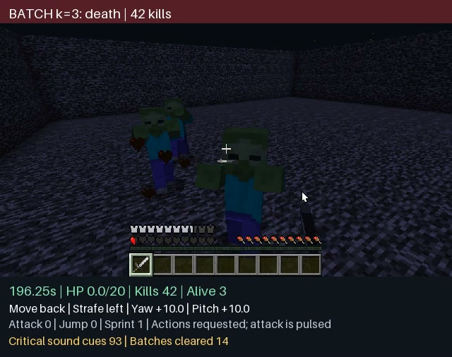
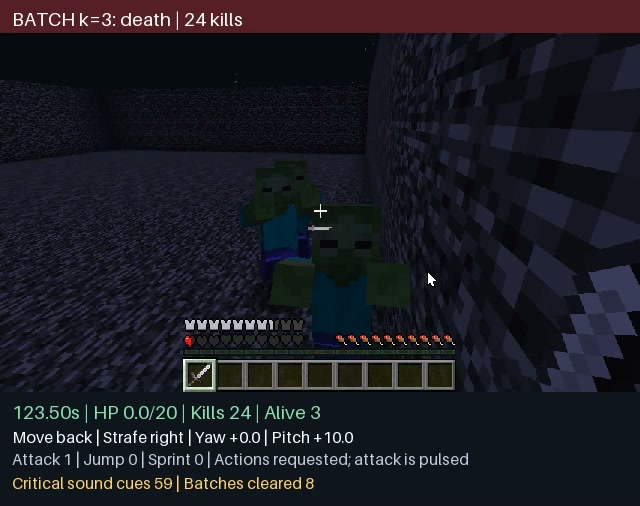
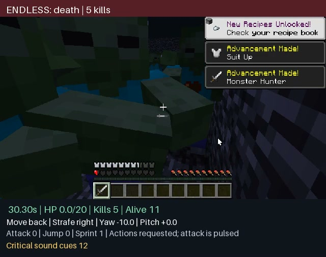
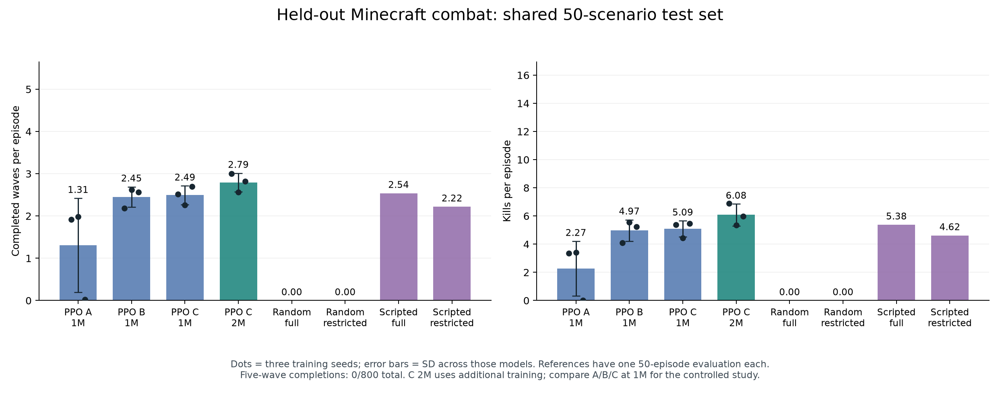
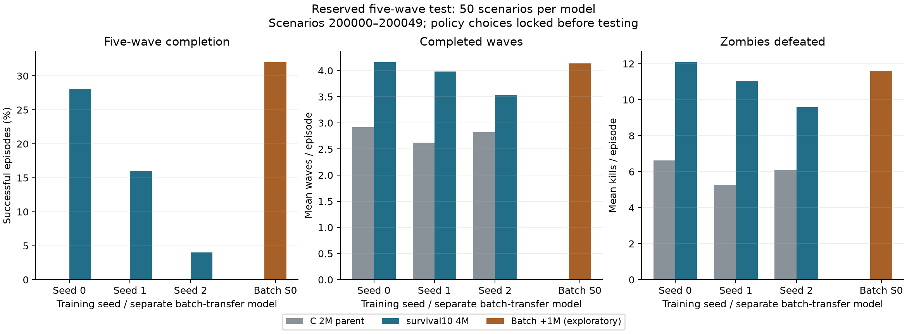
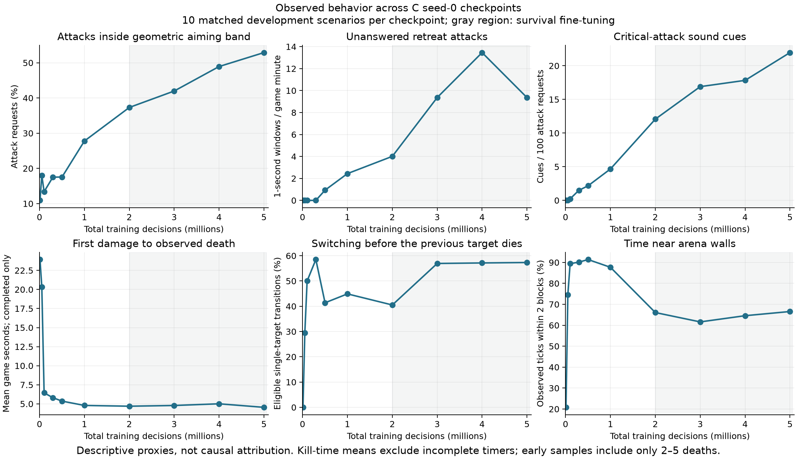
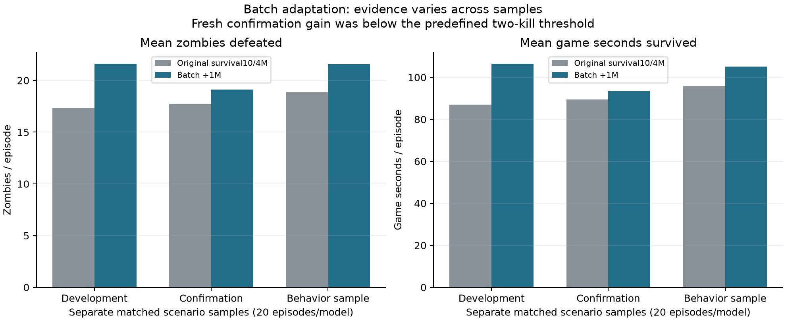

# CS557 collaborator meeting - November 25, 2026

**Start here:** [Plain-English project walkthrough](PROJECT_WALKTHROUGH.md) | [Printable PDF](PROJECT_WALKTHROUGH.pdf) | [How to run the saved policies](REPRODUCE.md)

This packet contains the project evidence for the meeting, prepared November 24. The main result is a learned policy that can beat all five waves, with a **28% reserved-test win rate for the preselected seed-0 model**. The three-seed survival recipe won 24/150 episodes overall. A separate exploratory batch demo defeated 42 zombies in one run.

## Suggested 15-minute walkthrough

1. Explain the task, observations, actions and A/B/C comparison using the first three pages of the guide.
2. Watch the five-wave win and a batch demo below.
3. Review the original and final test graphs. Keep the different tasks and test sets separate.
4. Review the behavior evidence, then agree on claims, writing tasks and whether to collect the pending human benchmark.

## Watch the runs

Click a thumbnail or the MP4 link to open/download the complete video. These are smaller H.264 viewing copies with the original dimensions, frame rate, full episode and existing two-second end hold preserved. They are **development showcases, not reserved-test episodes or typical-performance estimates**. Full video provenance and episode metrics are in [media-index.json](media-index.json).

### Five-wave clear - 15 kills

[Watch/download MP4](media/five-wave-clear.mp4?raw=true) - survival4M seed 0, scenario 51000. **Five waves, 15 kills, 67.4 game seconds.** This is a selected successful demonstration. The test result for this model is 14/50 wins.

### Strong batch run - 42 kills

[Watch/download MP4](media/batch-42-kills.mp4?raw=true) - batch +1M, scenario 52002. **14 batches of three, 42 kills, 196.25 game seconds**, ending in death. This was the strongest of three fixed recordings, which scored 12, 24 and 42 kills. The fresh-confirmation average was 19.1 kills.

### Another strong batch run - 24 kills

[Watch/download MP4](media/batch-24-kills.mp4?raw=true) - same batch model, scenario 52000. **Eight batches, 24 kills, 123.5 game seconds**, ending in death.

### Optional comparison - timed arrivals

[Watch/download MP4](media/timed-spawn-comparison.mp4?raw=true) - same batch model, one initial zombie followed by another every two seconds. **Five kills, 30.3 game seconds**, ending in death. This illustrates a harder, different task; it is not a failed five-wave episode.

## Results and graphs

| Evidence | What it answers | Files |
| --- | --- | --- |
| Original 800-episode test | How did A/B/C, C/2M and the references perform? | [Report](../study-20261121/README.md), [all episodes](../study-20261121/episodes.csv), [graph](../study-20261121/held-out-results.png) |
| Reserved 350-episode test | Did the selected survival models improve over their parents? | [Report](../final-study-20261122/README.md), [results](../final-study-20261122/reserved-test-results.json), [graph](../final-study-20261122/reserved-test.png) |
| 170 behavior episodes | What changed in aiming, critical cues, retreating and focus fire? | [Interpretation](../final-study-20261122/README.md#behavior-interpretation), [graph](../final-study-20261122/behavior-interpretation.png), [raw traces](evidence/behavior/) |
| Batch development and confirmation | Did batch fine-tuning improve survival? | [Summary](../final-study-20261122/batch-evidence.json), [graph](../final-study-20261122/batch-evidence.png), [full results](evidence/cs557-batch-finish-20261122b/results.json) |

## Models and supporting evidence

The [checkpoint index](checkpoint-index.json) lists **23 distinct checkpoints** and their SHA-256 hashes. These cover the original nine A/B/C models, C/2M parents, the selected three-seed survival recipe, the batch demo and the additional learning-history checkpoints. Aliases identify reused models. Each model has an unchanged `final.zip` and adjacent `final.json` metadata.

- Main five-wave demo: [survival4M seed 0](checkpoints/survival10_4M_seed0/).
- Exploratory batch demo: [batch +1M seed 0](checkpoints/batch_plus1M_seed0/).
- [Development evidence](evidence/) includes calibration, screening, selections, confirmations, episode CSVs and metadata. Historical source paths inside metadata identify the original machine; use the portable checkpoint index to run locally.
- [Behavior evidence](evidence/behavior/) includes all fifteen evaluation sets: per-episode detail, metadata and compressed per-tick traces.
- [Training logs](evidence/training-logs/) retain episode-monitor and PPO-progress CSVs for the original comparison and later candidates.
- [Asset provenance](asset-provenance.json) identifies the original source and hash of every copied artifact. [SHA256SUMS.txt](SHA256SUMS.txt) covers the final meeting packet.

The original reports remain intact. Intermediate checkpoint duplicates, full PNG frame sequences, local runtime caches and duplicate high-bitrate videos stay on the original PC. No Minecraft binaries are included. The complete meeting packet is roughly 135 MiB; individual files are below 33 MiB.

Use the **codex/windows-validation** branch when downloading the repository. Its README links this packet. Download the branch ZIP or clone it to keep the PDF, videos, checkpoints and evidence together.

## Claims to keep straight

The 42-kill video is a highlight, not an average. Batch confirmation missed its predefined improvement threshold. Better aiming, critical cues and hit-and-retreat windows are observed patterns, not proof of intention or causation. Focus-fire evidence is mixed. The later survival comparison changes both training time and settings. Human benchmarking and the final course report/presentation remain to be completed.
