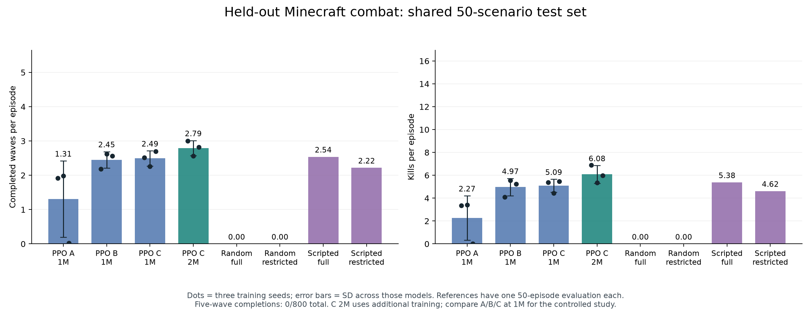

# Completed Minecraft combat study, 21 November 2026

All 800 held-out episodes finished. No controller cleared all five waves.
The three C policies continued to 2M steps averaged 2.79 completed waves and
6.08 kills, versus 2.49 waves and 5.09 kills for C at 1M. All three paired
training seeds improved; the mean wave gain was 0.30. These are descriptive
results with only three independently trained policies per PPO group.

`episodes.csv` contains all 800 episode records. `summary.csv` aggregates within
each trained model first, then reports the mean and sample SD across models.
Random and scripted references have one evaluation run, not independent training
replicates. `results.json` preserves per-model results and hashes of the original
CSV files. `paired-C-improvement.json` reports paired training-seed differences.
`provenance.json` records frozen source/configuration/scenarios and model hashes.
`SHA256SUMS.txt` verifies this export. Local absolute paths were removed; episode
metrics are unmodified. Large model binaries, logs and videos remain in the
checked local results packet, whose SHA256 is recorded in provenance.

The nine A/B/C runs were fresh 1M-step experiments (three seeds each). The C 2M
extension has twice the training budget and is a separate group. Selection used
validation scenarios 50000-50049 before testing on 100000-100049. Every model
used the same 50 test scenario seeds; Minecraft AI is not bit-exact across runs.
Full-view random/scripted references apply to A/B; restricted-view references
apply to C. Reward returns are not comparable across reward conditions.

For the next exploratory study, start with C 2M seed 0 because it led pre-test
validation (2.99 waves, 6.91 kills; seed 2 was close at 2.96 waves). It also scored
3.00 waves/6.90 kills on this test, but that score is not the selection criterion.
This completed test is now observed. Further tuning uses fresh development
scenarios 51000-51049 and reserves 200000-200049 for a new final evaluation after
selection is locked. It cannot retroactively improve this completed study.

Human contextual evaluation remains pending. The known Windows native shutdown
error remains documented; all sixteen supervised Python evaluations exited zero,
left no tracked descendants, and passed unchanged-checkpoint checks.
